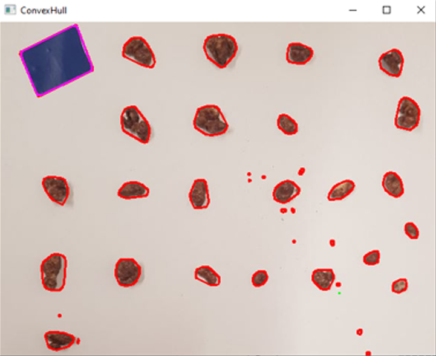
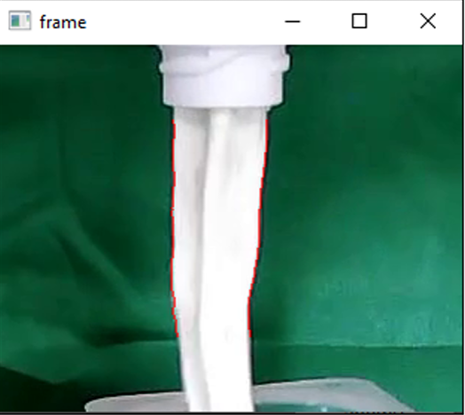
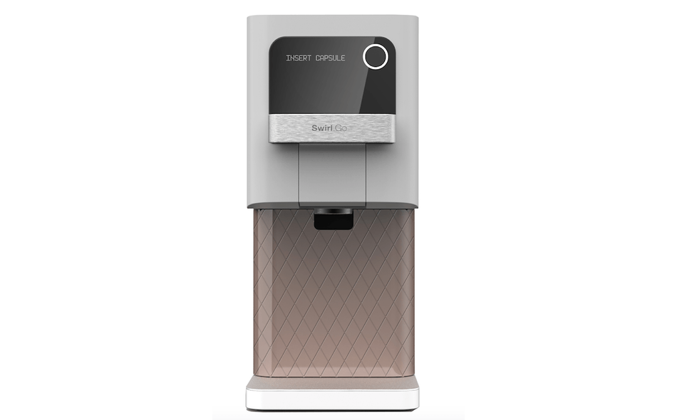
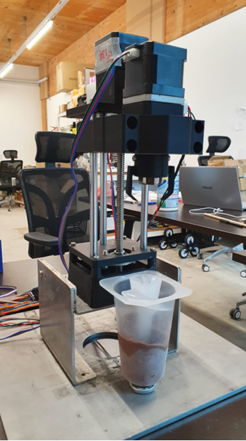
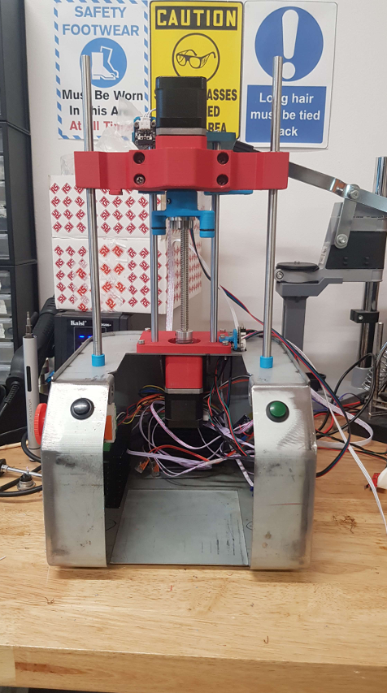
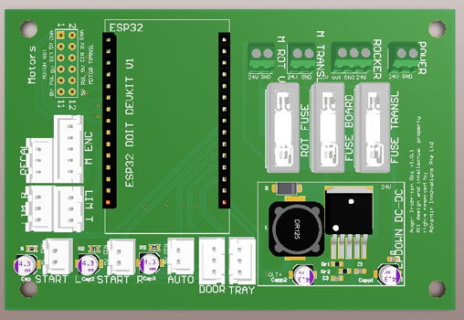

# Advantir Code Repository - Richard 2022

### Disclaimer: The works within this repository have been given prior consent for publication.

This repository acts as a backup of the code I wrote during my time as an R&D engineer intern at [Advantir Innovations](https://www.linkedin.com/company/advantir-innovations/about/). 

The product in question is the SwirlGO v3. A video demonstration of the product is available on [YouTube](https://youtu.be/769j9YeaPcw). 

## About this repository
This repository is divided in two main sections: Works done on the Advantir [SwirlGO v3.9.5](./AdvantirMachine3_9_5/) and [other prototypes](./Prototypes/). 
For further information regarding the products, refer to [Advantir Innovations LinkedIn](https://www.linkedin.com/company/advantir-innovations/about/). 

### UPDATE: Several urls regarding Advantir Innovations and SwirlGO have expired and are now defunct. 

For further information, refer to the folders ["./documentation"](./documentation/) and ["./media"](./media/).

## SwirlGO v3.9.5

The SwirlGO v3.9.5 uses a finite state machine (FSM) implemented on a Raspberry Pi. The Raspberry Pi communicates with an ESP32 microcontroller, responsible for motor control, and a touch-screen mini-PC used as the UI. The complete FSM is shown in the graphic below: 

## Prototypes
The prototypes displayed in this repository are divided in methods used for [data analysis](./Prototypes/Offline_Data_Processing/) and [mechanical prototypes](./Prototypes/SwirlGO_AlphaBuilds/). 

### Data analysis: 
1. Mixed-Ins size detector

This programme is used for offline data analysis for performance evaluation of the SwirlGO soft-serve machine when posed with different types of mixed-ins. 
The goal is to get a general overview of the mixed-ins' shape and size distribution before insertion to the capsule. Further quality analysis is done in the second step via "Soft-Serve Output Mixing Quality Evaluator". 
The programme detects individual pieces, draws a convex cure around them and then calculates height and width through its principle axes. Calculated values are then used for further analysis in fields such as quality control.

2. Soft-Serve Output Mixing Quality Evaluator

Quality evaluation is done via analysis of color and thickness of the soft-serve stream from the output nozzle. The goal is to keep the output as homogeneous as possible. An example is displayed in the graphic below. Here, the stream is outlined by the red outlines within the detected ROI. The color of the pixels within the two red outlines is analyzed in terms of variance and average over time. The thickness of the stream is calculated via the distance of the red outlines to one another. 

### Mechanical Prototypes:
1. UI Lighting Effect

The SwirlGO v4 is set to have a novel interface including different sets of buttons, touch interfaces and decorative lighting. An example of the machine in question is shown in the figure below: 

For further information, please refer to the documentation. 

2. Spiral Inserting Mechanism

This project implements the Spiral Inserting Mechanism, subject to be implemented in future SwirlGO machines. The code is implemented on an Arduino Uno using Nema 17 stepper motors in open loop for actuation. The goal of this machine is to insert and extract the spiral in and out of the ice cream capsule.

Here a picture of the prototype model: 

And the MK1 prototype: 

The embedded system board housing an ESP32 as the main microcontroller: 

